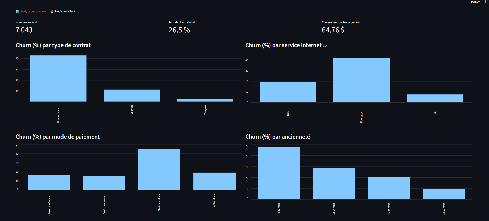
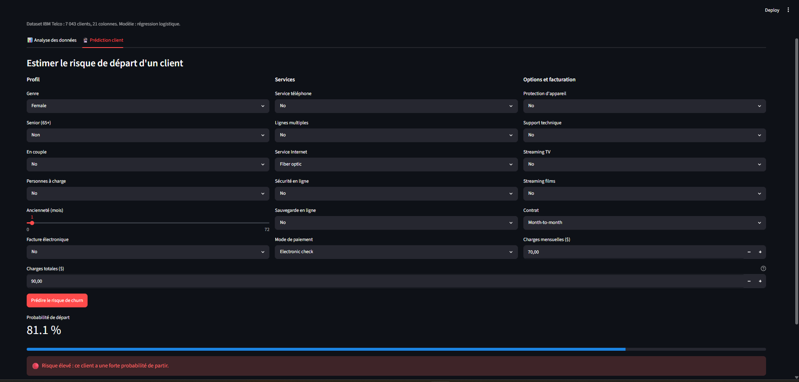
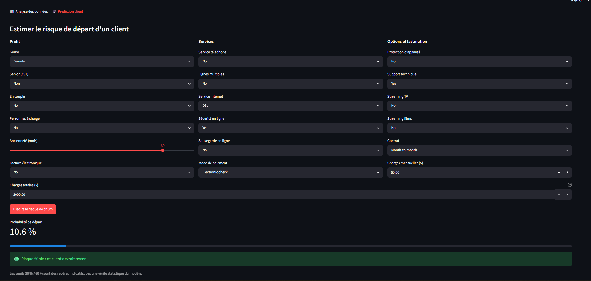

# Customer Churn Prediction & Analytics

Analyse et prédiction du désabonnement des clients d'un opérateur télécom, avec un dashboard interactif.

Auteure : Fatima Zahra Bouzzait, étudiante en 3ᵉ année de licence Génie Digital et Intelligence Artificielle, FST Settat.

## Objectif

Identifier les clients susceptibles de quitter l'entreprise à partir de leurs données de contrat, de services et de facturation, puis présenter les résultats dans une application web.

## Données

- Jeu de données public IBM Telco Customer Churn : 7 043 clients, 21 colonnes.
- Taux de churn global : 26,5 % (1 869 clients partis).
- Nettoyage : les 11 valeurs vides de `TotalCharges` concernent des clients avec `tenure = 0` (pas encore facturés). Elles ont été remplacées par 0.

## Technologies

Python, Pandas, NumPy, Matplotlib, Seaborn, Scikit-learn, SQLite, Streamlit, Jupyter, Git.

## Méthode

1. Analyse exploratoire : churn selon le contrat, l'ancienneté, les charges mensuelles, le mode de paiement et le service Internet.
2. Prétraitement : `StandardScaler` pour les variables numériques et `OneHotEncoder` pour les variables catégorielles, regroupés dans un `Pipeline` scikit-learn.
3. Modélisation : séparation 80/20 stratifiée, puis comparaison de trois modèles par validation croisée à 5 plis.
4. Analyse SQL : base SQLite et cinq requêtes d'analyse.
5. Dashboard : application Streamlit avec une page d'analyse et une page de prédiction pour un client.

## Résultats

### Comparaison des modèles

Validation croisée à 5 plis sur le jeu d'entraînement.

| Modèle | Recall | ROC-AUC |
|---|---|---|
| Régression logistique | 0,804 | 0,845 |
| Random Forest | 0,645 | 0,825 |
| Gradient Boosting | 0,528 | 0,847 |

Les ROC-AUC sont proches. La régression logistique a été retenue pour son meilleur recall et pour son interprétabilité.

### Performance sur le jeu de test

1 409 clients.

| Métrique | Valeur |
|---|---|
| Recall | 0,78 |
| Precision | 0,50 |
| F1-score | 0,61 |
| ROC-AUC | 0,84 |
| Accuracy | 0,74 |

Le recall est la métrique prioritaire : manquer un client qui part coûte plus cher que contacter par erreur un client qui serait resté. En contrepartie, la precision est de 0,50 : une alerte sur deux est une fausse alerte. L'accuracy est peu informative ici, car un modèle qui prédirait que personne ne part atteindrait environ 73 %.

### Facteurs associés au churn

- Risque plus élevé : fibre optique, contrat mensuel, paiement par chèque électronique, absence de sécurité en ligne et de support technique.
- Risque plus faible : ancienneté élevée, contrat de 2 ans, Internet DSL.

### Analyse SQL

| Segment | Clients | Taux de churn |
|---|---|---|
| Contrat mensuel | 3 875 | 42,7 % |
| Contrat 1 an | 1 473 | 11,3 % |
| Contrat 2 ans | 1 695 | 2,8 % |
| Ancienneté de 0 à 12 mois | 2 186 | 47,4 % |
| Ancienneté de 49 à 72 mois | 2 239 | 9,5 % |
| Contrat mensuel, fibre optique, 12 mois maximum | 916 | 70,2 % |

Les clients partis paient en moyenne 74,44 $ par mois, contre 61,27 $ pour les clients restés.

## Dashboard





## Utilisation

```bash
pip install -r requirements.txt
streamlit run app.py
```

Les fichiers `churn_model.joblib`, `model_columns.joblib` et `telco_clean.csv` doivent se trouver dans le même dossier que `app.py`. Ils sont générés par le notebook `Customer_Churn_Analysis.ipynb`.

## Structure du projet

```
Customer_Churn_Analysis.ipynb   Analyse, modèles, évaluation, SQL
app.py                          Dashboard Streamlit
churn_model.joblib              Modèle entraîné
model_columns.joblib            Colonnes attendues par le modèle
telco_clean.csv                 Données nettoyées
requirements.txt                Dépendances
images/                         Captures d'écran du dashboard
```

## Limites

- Les coefficients du modèle indiquent des associations, pas des relations de cause à effet.
- `MonthlyCharges`, `TotalCharges` et `tenure` sont fortement corrélées : leurs coefficients individuels sont à interpréter avec prudence.
- Le modèle est entraîné sur un jeu de données public, pas sur des données d'entreprise.
- Le dashboard fonctionne en local et n'est pas déployé en ligne.

## Améliorations possibles

- Ajuster le seuil de décision pour équilibrer recall et precision.
- Tester d'autres modèles avec réglage des hyperparamètres.
- Déployer le dashboard en ligne.
